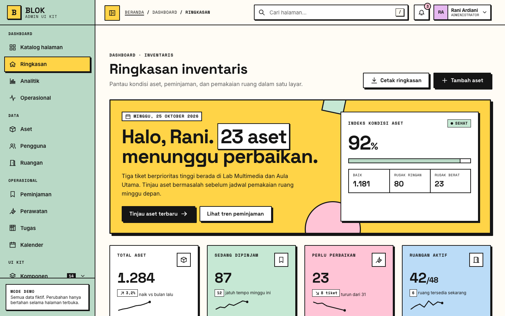
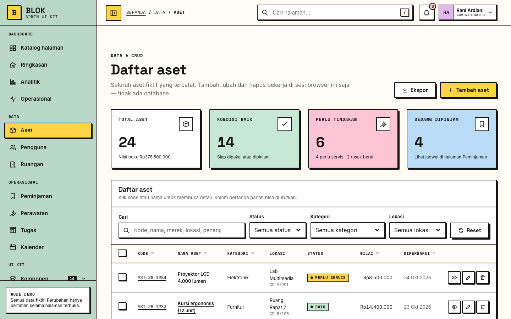
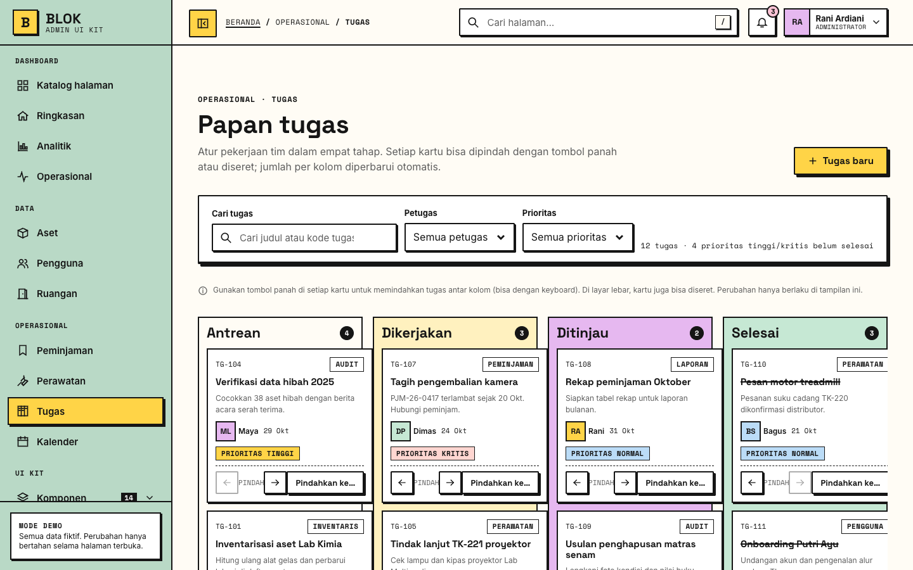
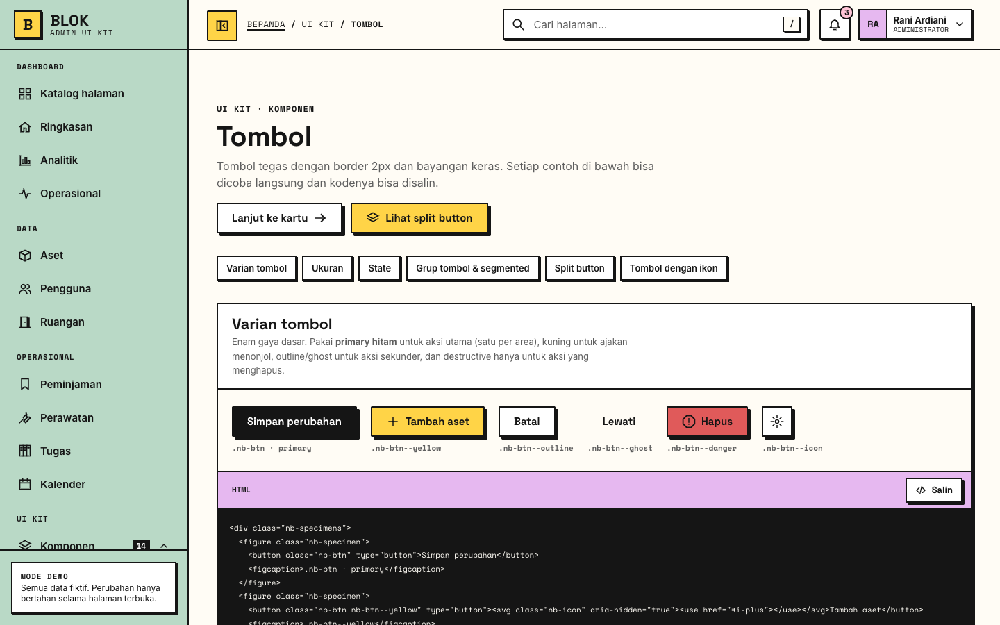
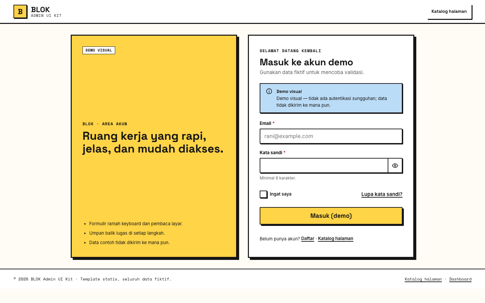
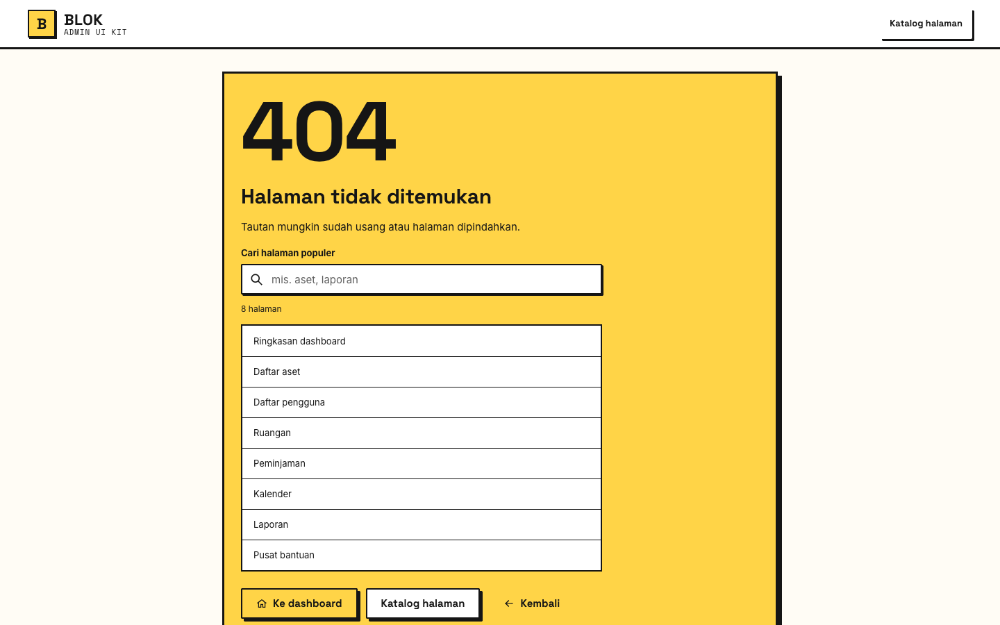
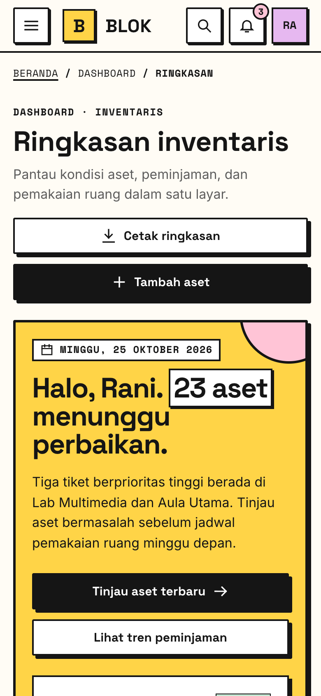

<div align="center">

# BLOK Admin UI Kit

**Template admin dashboard bergaya Neo-Brutalist: 47 halaman HTML, CSS, dan vanilla JavaScript.**
Tanpa framework, tanpa build step, tanpa backend. Tinggal buka di browser.

[](https://github.com/ranitachi/blok-admin-ui-kit/tags)
[](LICENSE)




</div>

> *English:* BLOK is a static, framework-free admin dashboard template in a Neo-Brutalist style (thick borders, hard offset shadows, bold colors). It has 47 pages, a full component library, CRUD demos, auth and error pages, and built-in documentation. It is accessible (WCAG AA), responsive from 320px, and needs no build step. The UI copy is in Indonesian.

---

## Daftar isi

- [Kenapa BLOK?](#kenapa-blok)
- [Tangkapan layar](#tangkapan-layar)
- [Mulai cepat](#mulai-cepat)
- [Isi template](#isi-template)
- [Struktur folder](#struktur-folder)
- [Design system](#design-system)
- [JavaScript](#javascript)
- [Membuat halaman baru](#membuat-halaman-baru)
- [Aksesibilitas & responsif](#aksesibilitas--responsif)
- [Pemeriksaan kualitas](#pemeriksaan-kualitas)
- [Batasan demo](#batasan-demo)
- [Versi & changelog](#versi--changelog)
- [Lisensi](#lisensi)

## Kenapa BLOK?

- **Gaya Neo-Brutalist yang konsisten.** Border hitam tebal, bayangan offset tanpa blur, palet kuning, sage, lavender, mint, dan pink, plus tipografi Space Grotesk, Inter, dan Space Mono.
- **Nol dependensi runtime.** Hanya HTML5, CSS3, dan vanilla JS, tanpa npm, bundler, framework, maupun `fetch`. Satu-satunya sumber eksternal adalah Google Fonts, dan template tetap berfungsi dengan font sistem bila offline.
- **Lengkap, bukan sekadar mockup.** Template ini punya tabel yang bisa diurutkan, difilter, dan dipaginasi, CRUD dengan validasi, kanban drag-and-drop, kalender, chart SVG, wizard multi-langkah, serta modal, drawer, toast, dan command palette.
- **Aksesibel sejak awal.** Struktur landmark dan heading rapi, focus ring terlihat, fokus terkunci di modal, Esc menutup overlay, perubahan status diumumkan lewat `aria-live`, dan preferensi `prefers-reduced-motion` dihormati.
- **Responsif dari 320px sampai 1440px+.** Di layar kecil sidebar berubah menjadi drawer dan tabel bisa digulir. Template juga punya stylesheet print.
- **Mudah dikembangkan.** Ada design token di satu berkas, penamaan BEM `.nb-*`, hook `data-*`, dan skrip `sync-shell` yang menjaga sidebar, breadcrumb, serta katalog tetap sinkron.

## Tangkapan layar

| Tabel data & CRUD | Kanban tugas |
|---|---|
|  |  |
| **Pustaka komponen** | **Halaman masuk (demo)** |
|  |  |
| **Halaman error 404** | **Tampilan mobile** |
|  |  |

## Mulai cepat

```bash
git clone https://github.com/ranitachi/blok-admin-ui-kit.git
cd blok-admin-ui-kit
python3 -m http.server 8000      # lalu buka http://localhost:8000/
```

Bisa juga membuka `index.html` langsung di browser, atau menyajikan folder ini dengan server statis apa pun: `npx serve`, Live Server di VS Code, Nginx, GitHub Pages, Netlify, dan sebagainya. `index.html` adalah **katalog** yang menautkan semua halaman.

## Isi template

| Kelompok | Halaman |
|---|---|
| **Dashboard** (4) | Katalog halaman · Ringkasan · Analitik · Operasional |
| **Data & CRUD** (7) | Aset (daftar, tambah, ubah, detail) · Pengguna (daftar, detail) · Ruangan |
| **Operasional** (4) | Peminjaman · Perawatan · Tugas (kanban) · Kalender |
| **Komponen UI Kit** (14) | Tombol · Kartu · Badge & status · Alert & toast · Modal & drawer · Dropdown & popover · Tab & akordeon · Navigasi · Tabel · Formulir · Chart & KPI · Timeline & konten · Empty & loading · Ikon & tipografi |
| **Halaman umum** (6) | Laporan · Notifikasi · Profil · Pengaturan · Harga · Pusat bantuan |
| **Autentikasi** (4) | Masuk · Daftar · Lupa kata sandi · Atur ulang kata sandi |
| **Error** (3) | 403 · 404 · 500 |
| **Dokumentasi** (5) | Mulai di sini · Indeks komponen · Design token · API JavaScript · Aksesibilitas |

**Total: 47 halaman.** Semua data adalah data fiktif untuk skenario inventaris dan aset sebuah institusi.

## Struktur folder

```
.
├── index.html                  Katalog halaman (diisi otomatis oleh tools/sync-shell.py)
├── dashboard*.html             Ringkasan, analitik, operasional
├── components/                 14 halaman pustaka komponen
├── pages/                      Halaman bisnis: CRUD, operasional, akun, laporan, dll.
├── auth/                       Masuk, daftar, lupa & atur ulang kata sandi
├── errors/                     403, 404, 500
├── documentation/              Dokumentasi interaktif (HTML)
├── assets/
│   ├── css/                    tokens · reset · layout · components · pages · responsive
│   └── js/                     icons · app · components · forms · tables · charts · data · records
│       └── pages/              Skrip khusus per halaman atau kelompok halaman
├── tools/
│   ├── sync-shell.py           Sinkronisasi sidebar, topbar, breadcrumb, dan katalog
│   └── qa/                     check-static.py, sweep.js
└── docs/screenshots/           Gambar untuk README
```

**Urutan CSS:** `tokens → reset → layout → components → pages → responsive`
**Urutan JS** (semua `defer`): `icons → app → components → forms`, lalu skrip halaman. Halaman di subfolder memakai awalan path `../assets/…`.

## Design system

Semua nilai visual didefinisikan sebagai CSS custom property di [`assets/css/tokens.css`](assets/css/tokens.css):

| Kategori | Contoh token |
|---|---|
| Warna | `--color-ink` `--color-canvas` `--color-paper` `--color-yellow` `--color-sage` `--color-lavender` `--color-mint` `--color-pink` `--color-blue` |
| Status | `--status-success` `--status-warning` `--status-danger` `--status-info` `--status-neutral` |
| Tipografi | `--font-heading` (Space Grotesk) · `--font-body` (Inter) · `--font-mono` (Space Mono) · `--fs-2xs` … `--fs-display` |
| Spasi | `--space-1` … `--space-12` · `--gutter` |
| Garis & bayangan | `--border` `--border-strong` `--shadow-xs` `--shadow-sm` `--shadow` `--shadow-lg` |
| Interaksi | `--tap-min` (44px) · `--focus-outline` · `--dur` · `--ease` |

Untuk mengganti tema, ubah token di berkas itu dan seluruh template akan ikut berubah. Daftar lengkap beserta swatch ada di halaman [`documentation/tokens.html`](documentation/tokens.html).

Kelas memakai penamaan BEM dengan awalan `.nb-` (misalnya `.nb-btn .nb-btn--yellow`, `.nb-card__head`). Indeks semua komponen ada di [`documentation/components.html`](documentation/components.html).

## JavaScript

Seluruh perilaku dipicu lewat atribut `data-*`, jadi tidak perlu menulis JS untuk komponen standar:

```html
<form data-validate novalidate>
  <label for="email">Email</label>
  <input id="email" name="email" type="email" required>

  <label for="pw">Kata sandi</label>
  <input id="pw" name="pw" type="password" minlength="8" required>
  <button type="button" data-password-toggle aria-controls="pw" aria-label="Tampilkan kata sandi">👁</button>
</form>
```

Selain lewat atribut, ada API global `NB` untuk dipanggil dari skrip:

```js
NB.toast({ type: "success", title: "Tersimpan (demo)", message: "Tidak ada data yang dikirim." });
NB.modal.open("modal-hapus");

document.querySelector("form").addEventListener("nb:valid-submit", (e) => {
  console.log(Object.fromEntries(e.detail.data));   // FormData dari form yang lolos validasi
});
```

Referensi lengkap (`NB.qs`, `NB.qsa`, `NB.ready`, `NB.toast`, `NB.modal`, `NB.forms`, `NB.display`, `NB.storage`, semua hook `data-*`, dan event kustom) ada di [`documentation/javascript.html`](documentation/javascript.html).

## Membuat halaman baru

1. Salin halaman yang mirip (misalnya `pages/help-center.html`), lalu ubah `<title>` (harus unik), meta description, dan isi `<main>`.
2. Tambahkan entri ke daftar `PAGES` di [`tools/sync-shell.py`](tools/sync-shell.py):
   `(key, path, label, kategori, ikon, fase, nav_parent)`
3. Jalankan `python3 tools/sync-shell.py`. Sidebar, topbar, breadcrumb, dan katalog di semua halaman akan diperbarui. Gunakan `--check` bila hanya ingin melihat perbedaannya.
4. Taruh CSS baru di akhir `assets/css/pages.css` dan JS khusus halaman di `assets/js/pages/`.

## Aksesibilitas & responsif

- Target **WCAG 2.1 AA**: kontras warna, label di setiap input, error dihubungkan lewat `aria-describedby`, dan target sentuh minimal 44px.
- Bisa dipakai sepenuhnya dengan keyboard: ada skip link, urutan Tab yang logis, fokus terkunci lalu dikembalikan di modal dan drawer, Esc menutup overlay, dan tombol panah bekerja di tab, menu, serta kalender.
- `prefers-reduced-motion` dihormati. Halaman **Pengaturan → Tampilan** juga punya opsi kepadatan, ukuran teks, dan "kurangi gerak".
- Breakpoint: `≥1440`, `≤1279`, `≤1023`, `≤767`, `≤374`, dan `print`. Tidak ada scroll horizontal di lebar 320px.

Checklist lengkap ada di [`documentation/accessibility.html`](documentation/accessibility.html).

## Pemeriksaan kualitas

```bash
python3 tools/sync-shell.py --check      # shell semua halaman sinkron
python3 tools/qa/check-static.py         # tautan mati, id ganda, ARIA menggantung, kelas tanpa CSS

# Uji browser di 5 lebar layar (perlu Node.js, puppeteer-core, dan Chrome/Chromium)
npm i --no-save puppeteer-core
python3 -m http.server 8000 &
CHROME_PATH="/path/ke/chrome" node tools/qa/sweep.js
```

`sweep.js` memeriksa setiap halaman di lebar 320, 375, 768, 1024, dan 1440 untuk menemukan scroll horizontal, error console atau JS, respons HTTP ≥400, chart yang tidak ter-render, dan sprite ikon yang hilang. Tambahkan `SHOTS=1` untuk menyimpan screenshot ke `tools/qa/shots/`.

## Batasan demo

Ini adalah **template front-end statis**:

- Tidak ada backend, database, atau autentikasi sungguhan. Form masuk dan daftar hanya demo visual dan tidak menyimpan kata sandi.
- Perubahan CRUD hanya bertahan selama halaman atau tab terbuka. Preferensi tampilan disimpan di `sessionStorage`.
- Semua nama, email (`example.com`), dan angka adalah data fiktif.

Untuk dipakai di produksi, sambungkan form dan tabel ke API milik Anda. Markup dan CSS bisa dipakai apa adanya, termasuk di dalam template engine seperti Blade, Twig, Jinja, atau komponen React/Vue.

## Versi & changelog

Proyek ini mengikuti [Semantic Versioning](https://semver.org/lang/id/). Setiap rilis diberi tag git (`v1.0.0`, `v1.1.0`, …). Riwayat perubahan ada di [CHANGELOG.md](CHANGELOG.md).

## Lisensi

[MIT](LICENSE) © 2026 Fachran Nazarullah. Bebas dipakai untuk proyek pribadi maupun komersial.
